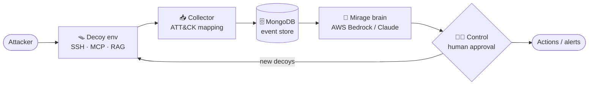

<div align="center">

# 🪞 MIRAGE

### An AI deception defense that turns a breach into an intelligence advantage.

*When an attacker gets in, they only ever touch a **fake** network — while an AI agent profiles them, plants tailored decoys, and learns from every move.*

<br>

[](#)
[](#)
[](#-testing)
[](#)
[](#)
[](#)

**[The problem](#-the-problem)** · **[How it works](#-how-it-works)** · **[Architecture](#-architecture)** · **[Quick start](#-quick-start)** · **[Testing](#-testing)** · **[Limitations](#-known-limitations)**

</div>

---

> **TL;DR** — Mirage is an *adaptive* AI honeynet. A defender agent on AWS Bedrock traps intruders in a decoy environment, maps their behavior to **MITRE ATT&CK**, plants decoys to keep them engaged, and builds a cross-session memory so each attack is handled faster than the last — all gated behind a human analyst and hardened against the **OWASP Agentic** threats the agent itself is exposed to.

## ⚡ One-command demo

```powershell
.\console.ps1          # starts MongoDB + opens the SOC console at http://127.0.0.1:8600
```

Then click **Run Workflow** to launch an attack, and scroll to **“Mirage is learning” → ▸ run learning demo** to watch the agent's knowledge curve climb live.

---

## 🎯 The problem

Security operations teams are **structurally outnumbered**:

- An attacker needs only **one** way in; defenders must cover **everything**.
- Real alerts drown in noise, so mean-time-to-detect is often measured in **days**.
- Once inside, an intruder moves laterally through **real** systems before anyone reacts.

Classic honeypots help — but they're static, so a skilled attacker fingerprints and leaves. And the obvious fix, putting an LLM in the defensive loop, creates a **new attack surface**: the agent can be prompt-injected, tricked into misusing tools, or have its memory poisoned.

> Mirage tackles both sides: a honeynet that **adapts** via an AI agent, and an agent that is **hardened** against the very techniques it defends against.

---

## 🧠 How it works

| Step | What happens |
|------|--------------|
| 🪤 **Trap** | A believable decoy environment — fake SSH shell, an MCP tool server, a RAG knowledge store — absorbs the intruder instead of real assets. Everything is seeded with **canary tokens**. |
| 🔎 **Profile & deceive** | The defender agent reads the attacker's behavior live, maps it to **MITRE ATT&CK**, and plants decoys tailored to what they seem to be after. |
| 🧑‍✈️ **Human in control** | Every consequential action is gated behind **analyst approval**, with a one-button **kill switch**. |
| 📚 **Learn** | A **cross-session incident memory** lets the agent recognize repeat techniques and reuse what worked before. |

---

## 🏗 Architecture

A live pipeline runs from intrusion to decision — and loops back:



- **Decoy environment** — emulated Cowrie SSH honeynet, a **real MCP (stdio)** tool server, and a **real RAG** store (Titan embeddings + Chroma) full of honey-documents.
- **Collector** — tails decoy logs, enriches each event, maps actions to **MITRE ATT&CK**, and writes to the **MongoDB** event store.
- **Mirage brain** — the defender policy on **AWS Bedrock** (Claude Sonnet for strategy; a small model, **Amazon Nova Micro**, for the “watch it learn” demo), consulting cross-session memory.
- **Control** — every proposed action passes through `mirage-control`, which re-checks it, auto-runs safe actions, and queues the rest for a human. Houses the kill switch.
- **Dashboard** — a FastAPI “SOC console” rendering the whole pipeline live from MongoDB, plus run analytics and the learning curve.

<details>
<summary><b>📂 Repository layout</b> (click to expand)</summary>

<br>

| Path | What's in it |
|------|--------------|
| `brain/` | The defender agent: policy, run loop, prompt, cross-session **memory**, and the **learning** engine. |
| `control/` | `MirageControl` — action gating, approval queue, kill switch, MCP server `mirage-control`. |
| `collector/` | Log collector, event enrichment, and the ATT&CK technique mapping. |
| `ai_traps/` | Real MCP tool server/client (stdio) and the RAG store (Chroma / Titan). |
| `attackers/` | Attacker agents — an adversary-emulation `sweep` and LLM personas (data-thief, injector, APT, red-team). |
| `honeynet/` | Cowrie-format SSH emulation and the wiki gateway. |
| `builder/` | Build mode: the agent designs the decoy environment (CLI / render / validate). |
| `defender/` | Defender service wiring. |
| `dashboard/` | FastAPI SOC console (`server.py`, `api.py`, `static/`) and a simpler Streamlit view (`app.py`). |
| `reliability/` | Reliability controls and kill-switch policy. |
| `canary/` | Canary-token filters and registry. |
| `integrations/` | SIEM export (ECS) and reports. |
| `eval/` | Evaluation matrix and analyst study. |
| `schemas/` | JSON schemas for actions, decoys, and events. |
| `local/run.py` | Local orchestrator and CLI entrypoint (`python -m local.run ...`). |
| `scripts/` | `demo_learning.py`, `many_events.py`, Mongo helper. |
| `tests/` | Test suite (366 tests, run against mongomock — no live DB needed). |
| `docs/` | Pitch deck, defense sheet, and technical report. |

</details>

### 🛡 Secure-AI measures (Track 2)

The agent is treated as a **threat surface**, mapped to **OWASP Agentic Security (ASI)**:

| Threat | Mirage's control |
|--------|------------------|
| **Prompt injection** `ASI01` | Attacker text is treated as data — never executed as instructions. |
| **Tool misuse** `ASI02` | Every tool call is re-checked by `mirage-control` before it runs. |
| **Memory poisoning** `ASI06` | Incident memory stores **only defender-side facts**, never raw attacker input. |
| **Runaway action** | Human approval gate + kill switch — nothing irreversible runs unattended. |

---

## 🚀 Quick start

### Prerequisites
- **Python 3.12**
- **MongoDB** running locally (default `mongodb://127.0.0.1:27017`)
- **AWS Bedrock** access in `us-west-2` — *optional*; only needed for the agent's LLM decisions and build mode. Tests and the no-LLM event demo run without it.

<details open>
<summary><b>🪟 Windows / PowerShell</b></summary>

```powershell
git clone https://github.com/MohamedKlila25/mirage.git
cd mirage

py -3.12 -m venv .venv312               # the .ps1 helpers expect the venv here
.\.venv312\Scripts\Activate.ps1
pip install -r requirements.txt

copy .env.example .env                  # optional — fill in AWS values for Bedrock
powershell -ExecutionPolicy Bypass -File scripts\mongo.ps1   # start / verify MongoDB
```
</details>

<details>
<summary><b>🐧 macOS / Linux</b></summary>

```bash
git clone https://github.com/<you>/mirage.git
cd mirage

python3.12 -m venv .venv312
source .venv312/bin/activate
pip install -r requirements.txt

cp .env.example .env                    # optional — fill in AWS values for Bedrock
# ensure a local MongoDB is running on 127.0.0.1:27017
```
</details>

### Run it

```powershell
.\console.ps1                               # SOC console at http://127.0.0.1:8600  ← start here
.\mirage.ps1 setup                          # agent designs the decoy environment (Bedrock, first run)
.\mirage.ps1 attack --policy agent --seed 2 # one agent-defended attack (Bedrock)
.\mirage.ps1 reset                          # clear attack data (keeps environment + learning history)
```

**No Bedrock? Deterministic traps + ATT&CK mapping still work:**
```bash
PYTHONPATH=. python scripts/many_events.py 1000   # populate the event store with 1000+ events across sessions
```

---

## 🧪 Testing

```bash
PYTHONPATH=. python -m pytest -q      # expect: 366 passed
```

The suite runs against **mongomock** — no live database or AWS access required. It exercises the collector, ATT&CK mapping, agent policy, control/approval flow, memory, canary tokens, MCP transport, RAG, reliability (grounding + Sigma), and the dashboard API.

---

## ⚠️ Known limitations

- **Bedrock required for the AI brain.** Adaptive defense, build mode, and the learning demo need AWS Bedrock (`us-west-2`). Without it the test suite and the deterministic no-LLM event demo still run, but the agent makes no live decisions.
- **The SSH honeynet is emulated** (Cowrie-*format*, in-process) rather than a full container — so logs and ATT&CK mapping stay realistic while staying portable. The MCP tool server and RAG store, by contrast, are **real**.
- **“Contained = detected” is by construction.** Because the attacker is already inside a honeynet, every action is logged — this measures containment and mapping fidelity, not detection of an intruder loose in a real network.
- **The learning signal is coverage- & memory-driven, not error-correction.** A deliberately small model (Nova Micro) makes growth visible; the measurable gains are rising ATT&CK **knowledge coverage** and **case reuse**, not a model that stops hallucinating.
- **Runtime data isn't committed.** `data/` (agent-built environment, decoy logs, trap logs, RAG index) is generated at run time and git-ignored, so a fresh clone starts empty — run `.\mirage.ps1 setup` to build an environment.
- **Demonstrator scope.** Single-node / local by default (the Docker Compose setup targets EC2 and isn't exercised by the local flow). This is a hackathon prototype, not a production-hardened IDS.

---

## 🧰 Tech stack

**AWS Bedrock** (Claude Sonnet / Haiku · Amazon Nova Micro · Titan embeddings) · **MongoDB** · **FastAPI** · **Model Context Protocol (MCP)** · **Chroma** · **MITRE ATT&CK** · **OWASP Agentic Security** · **Python 3.12**

---

<div align="center">

Built for the **Secure Horizon** hackathon — *Track 2: AI for Security & Secure AI*.
Prototype; no warranty.

</div>
