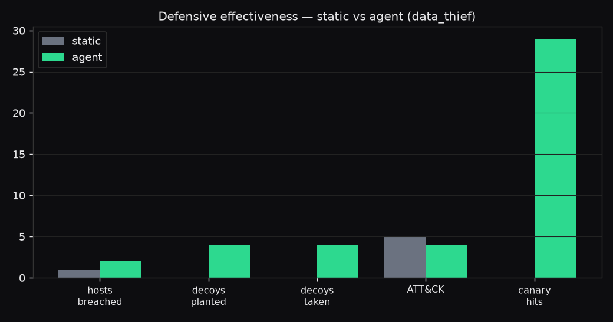
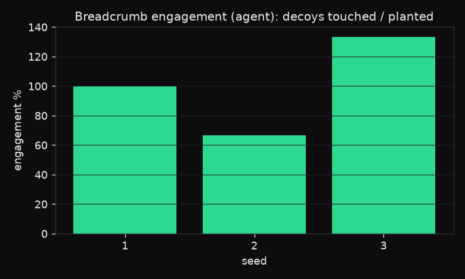

# Mirage — experiment results (data_thief)

3 static runs, 3 agent runs. Median [min–max] across seeds.

| metric | static | agent |
| --- | --- | --- |
| dwell (cmds) | 24 | 13 |
| hosts reached | 1 | 2 |
| ATT&CK techniques | 5 | 4 |
| decoys planted | 0 | 4 [3–6] |
| decoys touched | 0 | 4 |
| canary hits | 0 | 29 |
| trap hits | 0 | 0 |
| injection alerts | 0 | 0 |
| grounding rate | — | 0.75 [0.75–1] |
| hallucination rate | — | 0 |
| citation integrity | 1 | 1 |
| human-in-loop share | 0.071 | 0.083 [0–0.1] |
| safety blocks | 0 | 1 [0–2] |
| avg latency (s) | 0 | 22.54 [20.03–30.58] |
| time to detect (s) | — | 13.1 [12.4–19] |
| audit verified | mixed | mixed |

